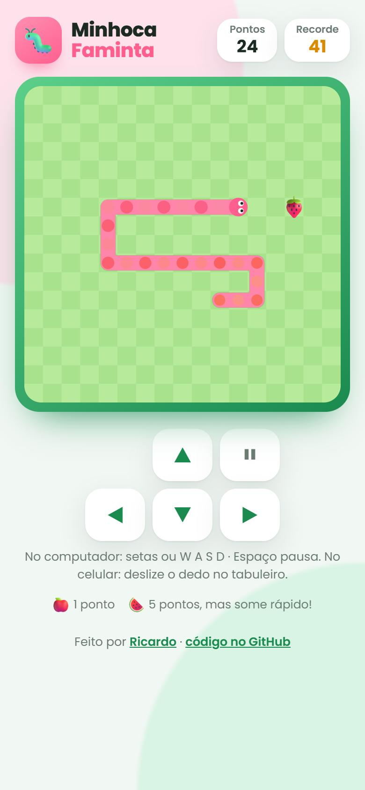
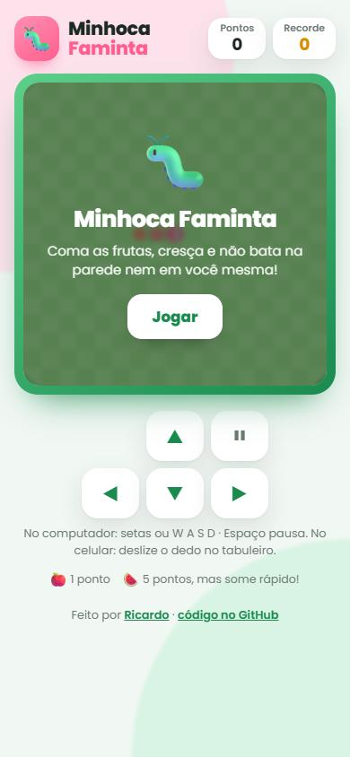

# 🐛 Minhoca Faminta

**Coma as frutas, cresça e não bata na parede nem em você mesma!**

&nbsp;&nbsp;

## Como jogar

- **No computador:** setas ou W A S D para virar. Espaço pausa.
- **No celular:** deslize o dedo no tabuleiro ou use os botões.
- 🍎 Cada fruta vale **1 ponto** e deixa a minhoca maior e mais rápida.
- 🍉 A cada 5 frutas aparece uma **melancia que vale 5 pontos**, mas some em 7 segundos.
- Seu **recorde** fica salvo no navegador.

## Detalhes

- Um único arquivo (`index.html`), com HTML, CSS e JavaScript puros, desenhado em Canvas.
- Curvas rápidas não se perdem: o jogo guarda até duas viradas seguidas e nunca deixa dar meia-volta.
- Se você trocar de aba, o jogo pausa sozinho.
- Ícones: [Fluent Emoji 3D](https://github.com/microsoft/fluentui-emoji), da Microsoft (licença MIT).
